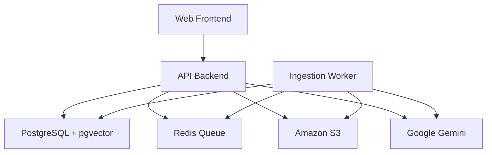
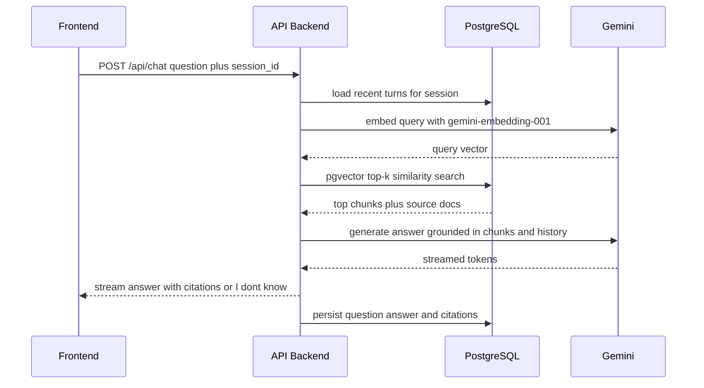
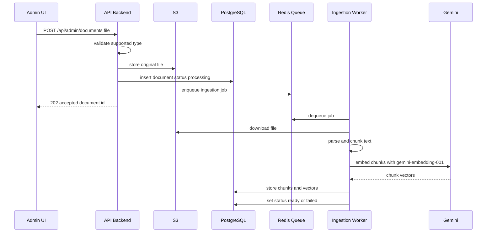
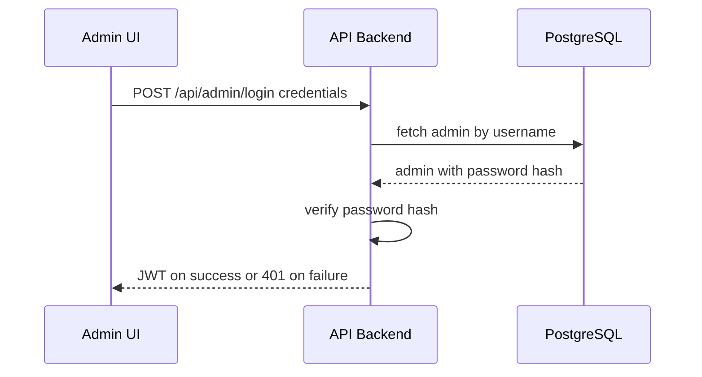
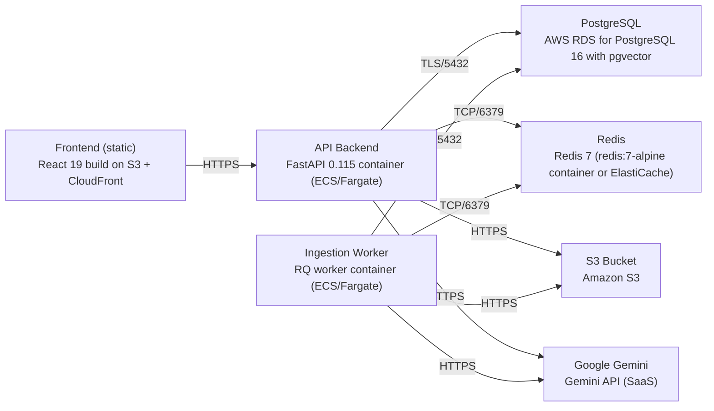

# Architecture

> Maintained by QuorQ AI SDLC. Text between `sdlc:auto` markers is regenerated; anything outside them is yours and is kept.

<!-- sdlc:auto:start narrative -->
## Overview

### ARCH-001 · approved · source: architecture:summary

RAG chatbot architecture (v1, approved): React 19 frontend (public chat + admin area), FastAPI 0.115 backend, background ingestion worker, single PostgreSQL 16 database, deployed on AWS.

Visitors chat anonymously by session ID; questions are embedded with gemini-embedding-001, matched via pgvector top-k similarity search against document chunks, and answered strictly from retrieved content by Gemini 2.5 Flash with citations and an 'I don't know' fallback. Admins upload PDF/.docx/text/Markdown files, stored in S3 and queued to a Redis-backed worker that parses, chunks, embeds and indexes them in PostgreSQL 16. All data (admins, documents, chunks+vectors, sessions, messages) lives in one PostgreSQL 16 database.

- ⚠ No explicit mapping is given in the architecture input from components/endpoints/entities to specific requirement IDs (US-001 through US-019); a requirement-to-architecture traceability matrix cannot be derived from this input alone.

### ARCH-002 · approved · source: architecture:components.web_frontend

Web Frontend component: React 19 app serving the public chat surface and the password-protected admin area.

Responsive React app. Public side: streaming chat page. Admin side (authenticated): login, document upload/list/remove, ingestion status display, and clear-history control.

### ARCH-003 · approved · source: architecture:components.api_backend

API Backend component: FastAPI 0.115 service orchestrating chat retrieval/generation and admin/ingestion operations.

Accepts questions, manages anonymous sessions and history, embeds queries, runs pgvector top-k retrieval, streams grounded Gemini answers with citations, authenticates admins, accepts uploads to S3, and enqueues ingestion jobs.

### ARCH-004 · approved · source: architecture:components.ingestion_worker

Ingestion Worker component: Python RQ worker (same FastAPI codebase) that processes uploaded documents into searchable vectors.

Consumes ingestion jobs from Redis, downloads the file from S3, parses to text, chunks it, embeds chunks with gemini-embedding-001, writes chunks+vectors to PostgreSQL, and updates document status.

### ARCH-005 · approved · source: architecture:components.postgres

PostgreSQL + pgvector component: single relational store for all application data including vector search.

PostgreSQL 16 (AWS RDS) with pgvector extension. Stores admin accounts, documents and ingestion status, per-session conversation history, and document-chunk embeddings used for similarity search.

### ARCH-006 · approved · source: architecture:components.redis_queue

Redis Queue component: durable job queue decoupling document upload from ingestion processing.

Redis 7. Lets the admin upload screen return immediately after enqueuing a job, and keeps the chat path responsive while ingestion runs asynchronously in the background worker.

### ARCH-007 · approved · source: architecture:components.s3_storage

Amazon S3 component: durable object storage for original uploaded documents.

Stores original uploaded PDF/.docx/text/Markdown files for management and future re-processing.

### ARCH-008 · approved · source: architecture:components.gemini

Google Gemini component: external SaaS AI provider for generation and embeddings.

Gemini 2.5 Flash generates grounded, cited chat answers. gemini-embedding-001 embeds both documents (at ingestion) and queries (at chat time).

### ARCH-009 · approved · source: architecture:critical_paths.ask_question

Critical path: visitor asks a question and receives a grounded, cited streamed answer.

Visitor submits a question for a session; backend loads prior turns, embeds the query with gemini-embedding-001, runs pgvector top-k retrieval over document chunks, builds a grounded prompt, streams Gemini 2.5 Flash output with citations or an 'I don't know' fallback when retrieval is insufficient, then persists the turn to the messages table.

### ARCH-010 · approved · source: architecture:critical_paths.upload_ingest

Critical path: admin uploads a document and the system ingests it into the knowledge base.

Admin uploads a supported file; backend validates type, stores it in S3, records a document row with status processing, and enqueues a Redis job. The ingestion worker parses, chunks, embeds with gemini-embedding-001, writes chunks+vectors, and marks the document ready or failed.

### ARCH-011 · approved · source: architecture:critical_paths.admin_auth

Critical path: admin authentication gating all admin endpoints.

Admin submits a password; backend verifies it against the stored password hash and issues a JWT used to guard all admin endpoints. Unauthenticated requests to admin endpoints are rejected.

### ARCH-012 · approved · source: architecture:entities

Data model: five tables in a single PostgreSQL 16 database covering admins, documents, chunks/vectors, sessions, and messages.

admins(id, username, password_hash, created_at). documents(id, filename, content_type, s3_key, status, error_message, uploaded_by, uploaded_at). document_chunks(id, document_id, chunk_index, content, embedding, created_at). chat_sessions(id, created_at, last_active_at). messages(id, session_id, role, content, citations, created_at).

### ARCH-013 · approved · source: architecture:endpoints

Seven REST endpoints covering chat, session history, admin auth, and document management.

POST /api/chat - submit a question for a session and stream a grounded, cited answer; creates a session if none supplied. GET /api/sessions/{session_id}/messages - return ordered conversation history for a session. POST /api/admin/login - authenticate an admin and issue a JWT. POST /api/admin/documents - upload a supported document (PDF/.docx/text/Markdown), store to S3, record as processing, enqueue ingestion; rejects unsupported types. GET /api/admin/documents - list all knowledge-base documents with name and ingestion status, with empty-state when none. DELETE /api/admin/documents/{document_id} - remove a document and its indexed chunks so content is no longer retrieved or cited. DELETE /api/admin/sessions/{session_id}/history - clear stored conversation history for a session.

### ARCH-014 · approved · source: architecture:deployment_nodes

Deployment topology on AWS: static frontend, two containerized services, managed database/queue/storage, and one external SaaS dependency.

Frontend (static): React 19 build on S3 + CloudFront. API Backend: FastAPI 0.115 container on ECS/Fargate, Python 3.12 / Uvicorn. Ingestion Worker: RQ worker container on ECS/Fargate, Python 3.12. PostgreSQL: AWS RDS for PostgreSQL 16 with pgvector. Redis: Redis 7 (redis:7-alpine container or ElastiCache). S3 Bucket: Amazon S3, managed. Google Gemini: Gemini API, external SaaS.

### ARCH-015 · approved · source: architecture:technology_decisions

Four core stack decisions with stated rationale: React 19, FastAPI 0.115, PostgreSQL 16 (with pgvector), and AWS.

Frontend: React 19 (alternatives considered: Vue, SvelteKit) - chosen to drive the two interactive, state-heavy surfaces: streamed-token chat with running history, and an admin area with upload progress and live ingestion status. Backend: FastAPI 0.115 (alternatives: Flask, Node/Express) - chosen for async request handling and native streaming responses fitting the retrieve-then-stream Gemini path, plus Python hosting for Gemini and document-parsing libraries. Database: PostgreSQL 16 (alternatives: MySQL, dedicated vector DB) - chosen so one database holds admins, documents+status, per-session history, and via pgvector the chunk embeddings and top-k similarity search, keeping the system simple at hundreds-to-low-thousands document scale. Cloud: AWS (alternatives: GCP, Azure) - chosen to provide S3 file storage, RDS PostgreSQL 16 with pgvector, and container hosting for API and worker in one place for a single-organisation deployment.
<!-- sdlc:auto:end narrative -->

<!-- sdlc:auto:start building-blocks -->
## Building Block View

| ID | Name | Technology | Responsibility | Depends on |
|---|---|---|---|---|
| web_frontend | Web Frontend | React 19 | Responsive React app serving the public streaming chat page and the authenticated admin area (login, document upload/list/remove, ingestion status, clear history). | api_backend |
| api_backend | API Backend | FastAPI 0.115 | FastAPI service: accepts questions, manages anonymous sessions and history, embeds queries, runs pgvector top-k retrieval, streams grounded Gemini answers with citations, authenticates admins, accepts uploads to S3 and enqueues ingestion jobs. | postgres, redis_queue, s3_storage, gemini |
| ingestion_worker | Ingestion Worker | Python RQ worker (FastAPI codebase) | Background worker that consumes ingestion jobs from Redis, downloads the file from S3, parses to text, chunks it, embeds chunks with gemini-embedding-001 and writes chunks+vectors to PostgreSQL, updating document status. | postgres, redis_queue, s3_storage, gemini |
| postgres | PostgreSQL + pgvector | PostgreSQL 16 (AWS RDS) with pgvector | Single relational store for admin accounts, documents and ingestion status, per-session conversation history, and document-chunk embeddings for similarity search via the pgvector extension. | — |
| redis_queue | Redis Queue | Redis 7 | Durable job queue decoupling upload from ingestion so the admin screen returns immediately and chat stays responsive. | — |
| s3_storage | Amazon S3 | Amazon S3 | Durable object storage for original uploaded PDF/.docx/text/Markdown files for management and re-processing. | — |
| gemini | Google Gemini | Google Gemini (SaaS) | External AI provider: Gemini 2.5 Flash generates grounded cited answers, gemini-embedding-001 embeds documents and queries. | — |

<!-- sdlc:auto:end building-blocks -->

<!-- sdlc:auto:start runtime -->
## Runtime View

### Ask a question and get a grounded, cited answer

Visitor submits a question for a session; backend loads prior turns, embeds the query, runs pgvector top-k retrieval, builds a grounded prompt, streams Gemini 2.5 Flash output with citations or an 'I don't know' fallback, then persists the turn.

- **Components:** web_frontend, api_backend, postgres, gemini
- **Modules:** chat_router, session_service, retrieval_service, generation_service, history_repository
- **Key functions:** post_chat(session_id, question), load_recent_turns(session_id, limit), embed_query(text), top_k_chunks(embedding, k), build_grounded_prompt(question, chunks, history), stream_answer(prompt), persist_turn(session_id, question, answer, citations)

### Upload and ingest a document

Admin uploads a supported file; backend validates type, stores it in S3, records a document row as processing and enqueues a Redis job; the worker parses, chunks, embeds with gemini-embedding-001, writes chunks+vectors and marks the document ready or failed.

- **Components:** web_frontend, api_backend, s3_storage, redis_queue, ingestion_worker, postgres, gemini
- **Modules:** admin_documents_router, upload_service, ingestion_job, parser, chunker, embedding_service, chunk_repository
- **Key functions:** upload_document(file), validate_type(content_type), put_object_s3(key, bytes), enqueue_ingest(document_id), run_ingestion(document_id), parse_to_text(file), chunk_text(text), embed_chunks(chunks), store_chunks(document_id, chunks, vectors), set_status(document_id, status)

### Admin authentication

Admin submits a password; backend verifies against the stored hash and issues a JWT used to guard all admin endpoints; unauthenticated requests are rejected.

- **Components:** web_frontend, api_backend, postgres
- **Modules:** admin_auth_router, auth_service, admin_repository, jwt_middleware
- **Key functions:** login(username, password), verify_password(password, hash), issue_token(admin_id), require_admin(request)

<!-- sdlc:auto:end runtime -->

<!-- sdlc:auto:start deployment-view -->
## Deployment View

| Name | Service | Runtime | Scaling | Environment |
|---|---|---|---|---|
| Frontend (static) | React 19 build on S3 + CloudFront | Static assets | CDN edge | dev |
| API Backend | FastAPI 0.115 container (ECS/Fargate) | Python 3.12 / Uvicorn | 1-2 tasks, horizontal | dev |
| Ingestion Worker | RQ worker container (ECS/Fargate) | Python 3.12 | 1 task | dev |
| PostgreSQL | AWS RDS for PostgreSQL 16 with pgvector | PostgreSQL 16 | single instance | dev |
| Redis | Redis 7 (redis:7-alpine container or ElastiCache) | Redis 7 | single node | dev |
| S3 Bucket | Amazon S3 | Managed | managed | dev |
| Google Gemini | Gemini API (SaaS) | External | managed | dev |

| Source | Target | Protocol |
|---|---|---|
| Frontend (static) | API Backend | HTTPS |
| API Backend | PostgreSQL | TLS/5432 |
| API Backend | Redis | TCP/6379 |
| API Backend | S3 Bucket | HTTPS |
| API Backend | Google Gemini | HTTPS |
| Ingestion Worker | Redis | TCP/6379 |
| Ingestion Worker | PostgreSQL | TLS/5432 |
| Ingestion Worker | S3 Bucket | HTTPS |
| Ingestion Worker | Google Gemini | HTTPS |

<!-- sdlc:auto:end deployment-view -->

<!-- sdlc:auto:start decisions -->
## Architecture Decisions

| Layer | Choice | ADR |
|---|---|---|
| Frontend | React 19 | [ADR-0001](adr/frontend.md) |
| Backend | FastAPI 0.115 | [ADR-0002](adr/backend.md) |
| Database | PostgreSQL 16 | [ADR-0003](adr/database.md) |
| Cloud | AWS | [ADR-0004](adr/cloud.md) |
<!-- sdlc:auto:end decisions -->

<!-- sdlc:auto:start links -->
## Related Documents

- [Data Model](data-model.md)
- [API Specification](api/openapi.yaml)
- [Architecture Decision Records](adr/README.md)
<!-- sdlc:auto:end links -->
