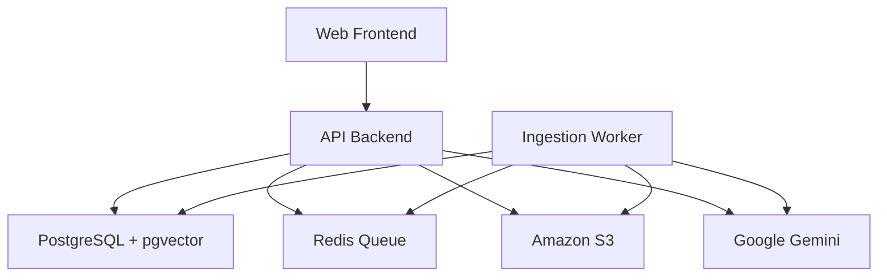
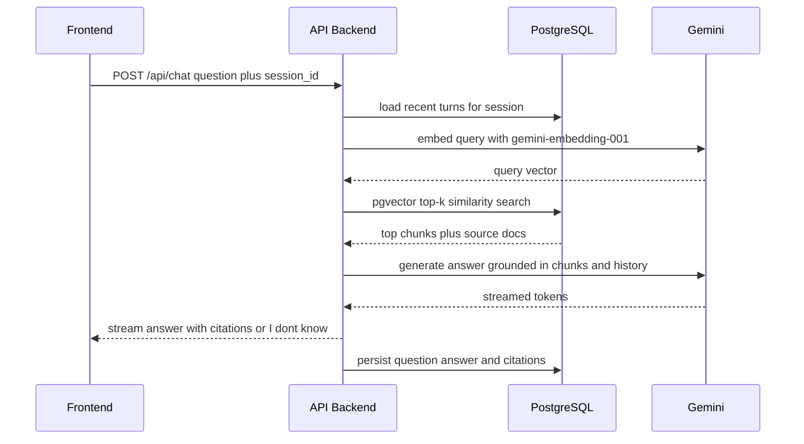
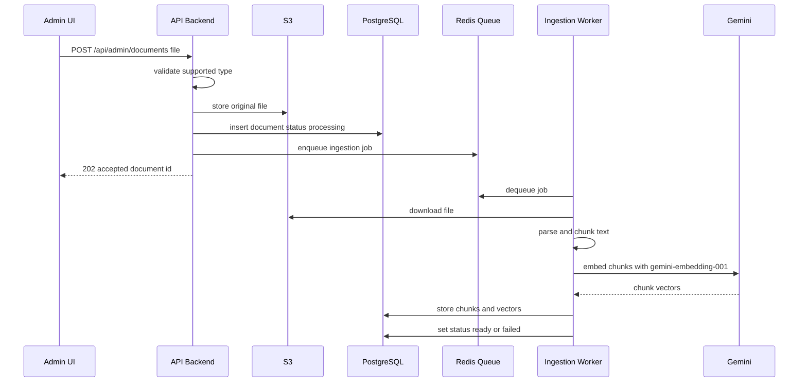
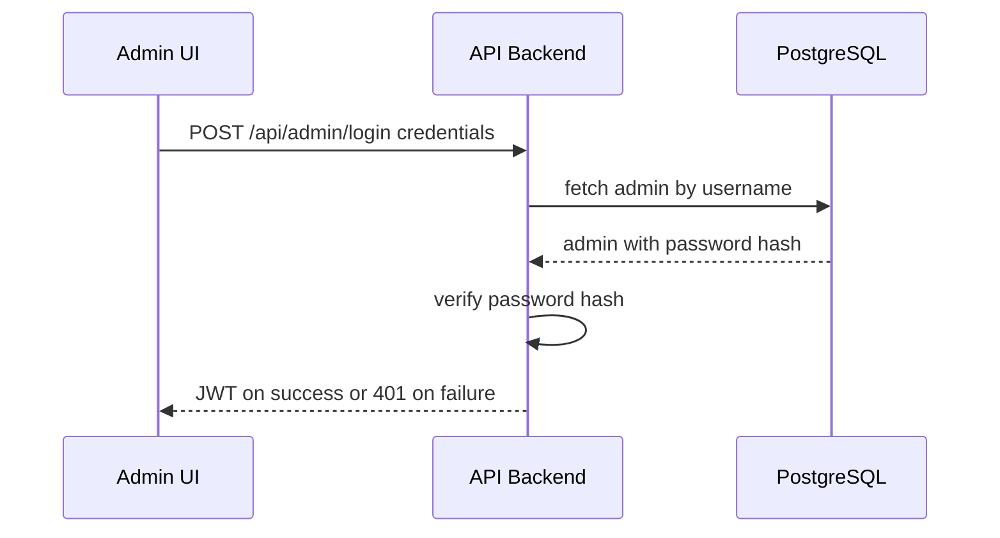
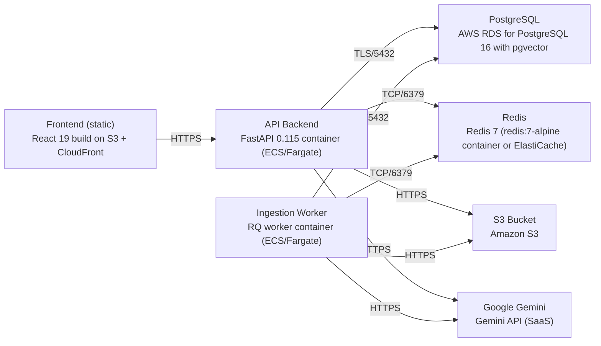

# Architecture

> Maintained by QuorQ AI SDLC. Text between `sdlc:auto` markers is regenerated; anything outside them is yours and is kept.

<!-- sdlc:auto:start narrative -->
## Overview

_No entries for this phase yet._
<!-- sdlc:auto:end narrative -->

<!-- sdlc:auto:start building-blocks -->
## Building Block View

| ID | Name | Technology | Responsibility | Depends on |
|---|---|---|---|---|
| web_frontend | Web Frontend | React 19 | Responsive React app serving the public streaming chat page and the authenticated admin area (login, document upload/list/remove, ingestion status, clear history). | api_backend |
| api_backend | API Backend | FastAPI 0.115 | FastAPI service: accepts questions, manages anonymous sessions and history, embeds queries, runs pgvector top-k retrieval, streams grounded Gemini answers with citations, authenticates admins, accepts uploads to S3 and enqueues ingestion jobs. | postgres, redis_queue, s3_storage, gemini |
| ingestion_worker | Ingestion Worker | Python RQ worker (FastAPI codebase) | Background worker that consumes ingestion jobs from Redis, downloads the file from S3, parses to text, chunks it, embeds chunks with gemini-embedding-001 and writes chunks+vectors to PostgreSQL, updating document status. | postgres, redis_queue, s3_storage, gemini |
| postgres | PostgreSQL + pgvector | PostgreSQL 16 (AWS RDS) with pgvector | Single relational store for admin accounts, documents and ingestion status, per-session conversation history, and document-chunk embeddings for similarity search via the pgvector extension. | — |
| redis_queue | Redis Queue | Redis 7 | Durable job queue decoupling upload from ingestion so the admin screen returns immediately and chat stays responsive. | — |
| s3_storage | Amazon S3 | Amazon S3 | Durable object storage for original uploaded PDF/.docx/text/Markdown files for management and re-processing. | — |
| gemini | Google Gemini | Google Gemini (SaaS) | External AI provider: Gemini 2.5 Flash generates grounded cited answers, gemini-embedding-001 embeds documents and queries. | — |

<!-- sdlc:auto:end building-blocks -->

<!-- sdlc:auto:start runtime -->
## Runtime View

### Ask a question and get a grounded, cited answer

Visitor submits a question for a session; backend loads prior turns, embeds the query, runs pgvector top-k retrieval, builds a grounded prompt, streams Gemini 2.5 Flash output with citations or an 'I don't know' fallback, then persists the turn.

- **Components:** web_frontend, api_backend, postgres, gemini
- **Modules:** chat_router, session_service, retrieval_service, generation_service, history_repository
- **Key functions:** post_chat(session_id, question), load_recent_turns(session_id, limit), embed_query(text), top_k_chunks(embedding, k), build_grounded_prompt(question, chunks, history), stream_answer(prompt), persist_turn(session_id, question, answer, citations)

### Upload and ingest a document

Admin uploads a supported file; backend validates type, stores it in S3, records a document row as processing and enqueues a Redis job; the worker parses, chunks, embeds with gemini-embedding-001, writes chunks+vectors and marks the document ready or failed.

- **Components:** web_frontend, api_backend, s3_storage, redis_queue, ingestion_worker, postgres, gemini
- **Modules:** admin_documents_router, upload_service, ingestion_job, parser, chunker, embedding_service, chunk_repository
- **Key functions:** upload_document(file), validate_type(content_type), put_object_s3(key, bytes), enqueue_ingest(document_id), run_ingestion(document_id), parse_to_text(file), chunk_text(text), embed_chunks(chunks), store_chunks(document_id, chunks, vectors), set_status(document_id, status)

### Admin authentication

Admin submits a password; backend verifies against the stored hash and issues a JWT used to guard all admin endpoints; unauthenticated requests are rejected.

- **Components:** web_frontend, api_backend, postgres
- **Modules:** admin_auth_router, auth_service, admin_repository, jwt_middleware
- **Key functions:** login(username, password), verify_password(password, hash), issue_token(admin_id), require_admin(request)

<!-- sdlc:auto:end runtime -->

<!-- sdlc:auto:start deployment-view -->
## Deployment View

| Name | Service | Runtime | Scaling | Environment |
|---|---|---|---|---|
| Frontend (static) | React 19 build on S3 + CloudFront | Static assets | CDN edge | dev |
| API Backend | FastAPI 0.115 container (ECS/Fargate) | Python 3.12 / Uvicorn | 1-2 tasks, horizontal | dev |
| Ingestion Worker | RQ worker container (ECS/Fargate) | Python 3.12 | 1 task | dev |
| PostgreSQL | AWS RDS for PostgreSQL 16 with pgvector | PostgreSQL 16 | single instance | dev |
| Redis | Redis 7 (redis:7-alpine container or ElastiCache) | Redis 7 | single node | dev |
| S3 Bucket | Amazon S3 | Managed | managed | dev |
| Google Gemini | Gemini API (SaaS) | External | managed | dev |

| Source | Target | Protocol |
|---|---|---|
| Frontend (static) | API Backend | HTTPS |
| API Backend | PostgreSQL | TLS/5432 |
| API Backend | Redis | TCP/6379 |
| API Backend | S3 Bucket | HTTPS |
| API Backend | Google Gemini | HTTPS |
| Ingestion Worker | Redis | TCP/6379 |
| Ingestion Worker | PostgreSQL | TLS/5432 |
| Ingestion Worker | S3 Bucket | HTTPS |
| Ingestion Worker | Google Gemini | HTTPS |

<!-- sdlc:auto:end deployment-view -->

<!-- sdlc:auto:start decisions -->
## Architecture Decisions

| Layer | Choice | ADR |
|---|---|---|
| Frontend | React 19 | [ADR-0001](adr/frontend.md) |
| Backend | FastAPI 0.115 | [ADR-0002](adr/backend.md) |
| Database | PostgreSQL 16 | [ADR-0003](adr/database.md) |
| Cloud | AWS | [ADR-0004](adr/cloud.md) |
<!-- sdlc:auto:end decisions -->

<!-- sdlc:auto:start links -->
## Related Documents

- [Data Model](data-model.md)
- [API Specification](api/openapi.yaml)
- [Architecture Decision Records](adr/README.md)
<!-- sdlc:auto:end links -->
