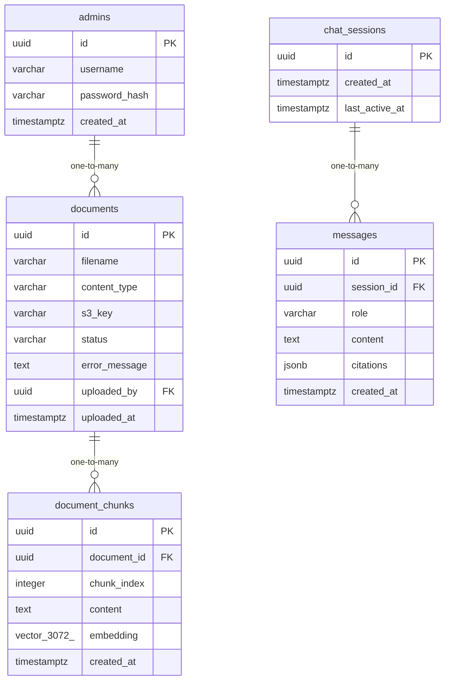

# Data Model

<!-- sdlc:auto:start entities -->
### admins

| Field | Type | PK | FK | Nullable |
|---|---|---|---|---|
| id | uuid | True | — | False |
| username | varchar | False | — | False |
| password_hash | varchar | False | — | False |
| created_at | timestamptz | False | — | False |

### documents

| Field | Type | PK | FK | Nullable |
|---|---|---|---|---|
| id | uuid | True | — | False |
| filename | varchar | False | — | False |
| content_type | varchar | False | — | False |
| s3_key | varchar | False | — | False |
| status | varchar | False | — | False |
| error_message | text | False | — | True |
| uploaded_by | uuid | False | admins.id | True |
| uploaded_at | timestamptz | False | — | False |

### document_chunks

| Field | Type | PK | FK | Nullable |
|---|---|---|---|---|
| id | uuid | True | — | False |
| document_id | uuid | False | documents.id | False |
| chunk_index | integer | False | — | False |
| content | text | False | — | False |
| embedding | vector(3072) | False | — | False |
| created_at | timestamptz | False | — | False |

### chat_sessions

| Field | Type | PK | FK | Nullable |
|---|---|---|---|---|
| id | uuid | True | — | False |
| created_at | timestamptz | False | — | False |
| last_active_at | timestamptz | False | — | False |

### messages

| Field | Type | PK | FK | Nullable |
|---|---|---|---|---|
| id | uuid | True | — | False |
| session_id | uuid | False | chat_sessions.id | False |
| role | varchar | False | — | False |
| content | text | False | — | False |
| citations | jsonb | False | — | True |
| created_at | timestamptz | False | — | False |
<!-- sdlc:auto:end entities -->

<!-- sdlc:auto:start relationships -->
| Source | Target | Type |
|---|---|---|
| admins | documents | one-to-many |
| documents | document_chunks | one-to-many |
| chat_sessions | messages | one-to-many |
<!-- sdlc:auto:end relationships -->

<!-- sdlc:auto:start er-diagram -->

<!-- sdlc:auto:end er-diagram -->
