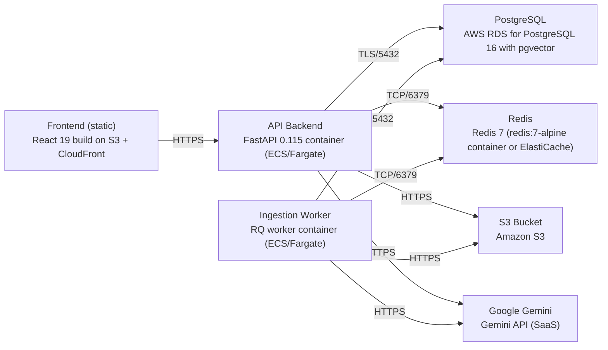

# Deployment Guide

> Maintained by QuorQ AI SDLC. Text between `sdlc:auto` markers is regenerated; anything outside them is yours and is kept.

<!-- sdlc:auto:start how-it-deploys -->
Pushes to `main` run `.github/workflows/deploy.yml`, which builds the API image (if there is a backend) and deploys the SPA to AWS Amplify. Commits touching only `docs/sdlc/**` don't deploy. Deployments can also be started from the platform's Deployment tab.
<!-- sdlc:auto:end how-it-deploys -->

<!-- sdlc:auto:start environments -->
| Name | Service | Runtime | Scaling | Environment |
|---|---|---|---|---|
| Frontend (static) | React 19 build on S3 + CloudFront | Static assets | CDN edge | dev |
| API Backend | FastAPI 0.115 container (ECS/Fargate) | Python 3.12 / Uvicorn | 1-2 tasks, horizontal | dev |
| Ingestion Worker | RQ worker container (ECS/Fargate) | Python 3.12 | 1 task | dev |
| PostgreSQL | AWS RDS for PostgreSQL 16 with pgvector | PostgreSQL 16 | single instance | dev |
| Redis | Redis 7 (redis:7-alpine container or ElastiCache) | Redis 7 | single node | dev |
| S3 Bucket | Amazon S3 | Managed | managed | dev |
| Google Gemini | Gemini API (SaaS) | External | managed | dev |
<!-- sdlc:auto:end environments -->

<!-- sdlc:auto:start live -->
**Frontend URL:** https://pc60802045d88.d3j61xaup4zgrx.amplifyapp.com

**Backend URL:** https://16-147-122-182.sslip.io/apps/c60802045d88/

**Database:** PostgreSQL · app

**Version:** 1d9f98111ac4

**Commit:** `1d9f981`

**Finished:** 2026-10-27
<!-- sdlc:auto:end live -->

<!-- sdlc:auto:start topology -->

<!-- sdlc:auto:end topology -->
